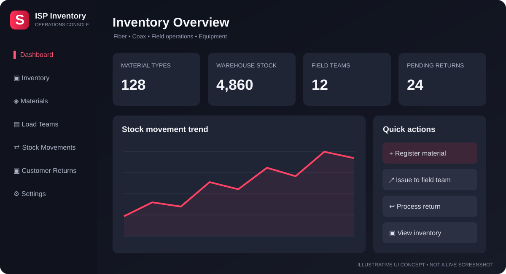

# ⚡ ISP INVENTORY

### Fiber • Coax • Equipment • Field Teams

**Dark-themed inventory and operations management for Internet Service Providers**

*Illustrative dark UI concept — not an application screenshot. Sample values are fictional.*

[**Download v2.0 Source ZIP**](./ISP-Inventory-v2.0.zip) · [**Previous v1.8.4 Source**](./OLDER%20Version/ISP-Inventory-v1.8.4) · [**Report an Issue**](https://github.com/Zero-Shad0w/Inventory/issues)

---

## Overview

ISP Inventory brings warehouse stock, technician allocations, customer equipment returns and operational records into one system. It is designed for ISP workflows involving **fiber optic, coaxial and network equipment**.

> **Release status:** The v2.0 source/build-kit ZIP is published. It is **not** a verified, precompiled Windows EXE. The older versions remain available for reference.

## ✨ Core features

| Module | What it helps you manage |
| :-- | :-- |
| 📦 **Materials & categories** | Register and organize ISP materials by SKU, model and category |
| 🏬 **Warehouse inventory** | Review quantities, locations and stock history |
| 🚐 **Field teams** | Issue stock to teams and track allocated materials |
| 🔄 **Stock movements** | Record receipts, transfers, consumption and returns |
| 📡 **Customer equipment** | Track returned modems, ONTs, receivers and related devices |
| 🛠️ **Operations** | Work orders, repairs and technical sign-offs |
| 👥 **Users & roles** | Control access by account and permission |
| 🗄️ **Backups** | Protect SQLite data and associated files |
| 🎨 **Branding** | Dark interface with configurable company appearance |

Actual availability and behavior depend on the downloaded release; consult its included documentation.

## 🖥️ Screenshots

The dashboard and appearance-settings screenshots supplied by the project owner will be displayed here when their standalone PNG files are committed under `docs/images/`. The illustration above is currently a design concept, not an actual screenshot.

## 🖥️ Interface preview

The image above is a **design illustration**, not a capture of the running application. A real dashboard screenshot will be added after the Windows build and UI are verified. This avoids presenting fictional inventory counts or an untested layout as actual software output.

## 🆕 What's new in v2.0

- **Remember login** option on the Windows desktop login screen, using encrypted local credential storage where available.
- **One-character minimum** for usernames and passwords, as requested for testing. **Warning:** one-character passwords are unsafe for real or shared-network deployments.
- **Custom installation directory** option in the Windows installer configuration.
- Preserves inventory, team operations, database connectivity and existing customization features from earlier versions.

The v2.0 ZIP is a test/source package. Test the Windows build and sign-in behavior before production use.

## Changes introduced in v1.8.4

- **Administrator user controls:** delete (deactivate and revoke access), disable/enable accounts, and reset passwords. Historical stock movements and audit references remain intact.
- **Login fixes:** errors display inline and users can retry immediately without restarting the application.
- **Local/shared connection controls:** configure the local application port or enter a shared server IP/hostname and port separately. Server listening-port changes require a restart.
- **Custom S.ico:** retained for the Windows application, installer, and shortcuts.

See the [v1.8.4 changelog](./OLDER%20Version/ISP-Inventory-v1.8.4/CHANGELOG.md) for details.

## 📊 Version comparison

| Capability | v1.8.4 | v2.0 (source ZIP) |
| :-- | :--: | :--: |
| Inventory and materials management | ✅ | ✅ |
| Team stock allocation and returns | ✅ | ✅ |
| Local / shared database connection | ✅ | ✅ |
| Custom red S icon | ✅ | ✅ |
| Separate connection port controls | ✅ | ✅ |
| Admin disable/delete user and password reset | ✅ Documented | ✅ Included |
| Improved login retry/error feedback | ✅ Documented | ✅ Included |
| Remember username/password | Updated source | Included in test package |
| Password minimum | 6 in updated source | 1 character |
| Choose installer folder | Not verified | Configured in test package |
| Windows installer | Not verified | Build required |

The table reflects published source/build-kit descriptions, not independent Windows runtime verification.

## 🚀 Getting started on Windows

1. **Download** [ISP-Inventory-v2.0.zip](./ISP-Inventory-v2.0.zip).
2. **Extract** the ZIP to a writable location.
3. **Read** the build and network instructions inside the extracted package.
4. On a Windows build computer with Node.js 22.5+ and internet access, run `powershell -ExecutionPolicy Bypass -File .\\BUILD-ONE-CLICK-INSTALLER.ps1` from the extracted project folder. The ZIP is editable source/build material, **not** a precompiled EXE.
5. **Back up your existing data** before upgrading from an earlier version.

### Local vs shared database

| Local mode | Shared mode |
| :-- | :-- |
| Database is hosted on the individual PC | A central host serves the shared database |
| Useful for one-PC installations | Useful for several staff computers |
| Accounts and inventory stay local | Clients use the same server-side accounts and inventory |

Shared clients connect to the application server over the LAN — **not directly to a SQLite file on a network drive**. Follow the included network setup guide, configure firewall rules carefully and do not expose the service directly to the public internet.

## 🔐 Preserve your inventory data

> [!IMPORTANT]
> **Never overwrite or delete an existing `data/` directory when upgrading.** Back up the database, evidence, material images and related attachment folders. Confirm the actual data path for your installation and test a restore before production use.

Do not commit customer data, passwords, production databases, backup files or secrets to this public repository.

## 🏗️ Windows EXE build status

The repository contains the [v2.0 build-kit ZIP](./ISP-Inventory-v2.0.zip). The existing [GitHub Actions workflow](./.github/workflows/build-windows-installer.yml) still targets the older v1.8.4 source tree and **does not build v2.0 automatically**. Use the v2.0 package's included build script on Windows, or update the workflow before attempting a v2.0 CI build.

**A successful Windows installer build has not been independently verified here.**

## 📁 Previous versions

Older source archives and the v1.8.4 source tree are grouped in [**OLDER Version**](./OLDER%20Version/). The current [v2.0 ZIP](./ISP-Inventory-v2.0.zip) remains in the repository root.

## 🧭 Roadmap

- Validate the published v2.0 source package
- Test user management, login and port settings on Windows
- Build and verify the installer using GitHub Actions
- Publish the supplied genuine dashboard and settings screenshots as standalone PNG assets
- Improve release documentation and versioned changelogs

---

**Built for ISP warehouse and field operations**

*ISP Inventory • Zero-Shad0w*

